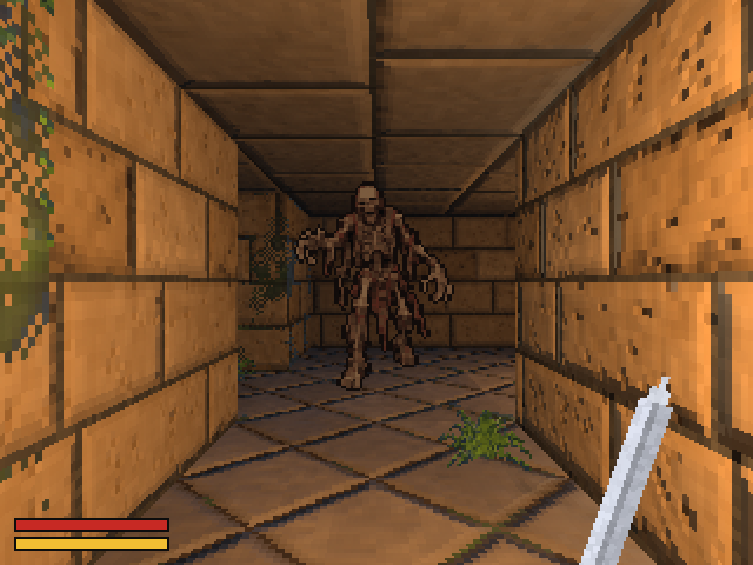

# ZRPG

*An RPG for busy people.*

ZRPG is an open-source, minimalist, first-person dungeon crawler roguelike in
the spirit of Dungeon Hack, Lands of Lore, Eye of the Beholder and Anvil of
Dawn: grid movement, 90° turns, real-time combat, and endless seeded floors.
Pick it up, play a floor, put it down.



Built with Rust and [Bevy](https://bevy.org). Renders at 320×240, scaled up
with crisp pixels. Runs on Linux, in the browser, and on Android handhelds.

## Run

```sh
cargo run --release                 # random seed
cargo run --release -- --seed 42    # a specific dungeon
cargo run --release -- --auto       # let it play itself
scripts/build-web.sh                # browser build in target/web/
scripts/build-android.sh            # APK (needs the Android SDK + NDK)
```

On the web, `?seed=42` and `?auto` in the page URL do the same as the flags.
See [docs/PLATFORMS.md](docs/PLATFORMS.md) for web and Android details and
[docs/TOOLCHAIN.md](docs/TOOLCHAIN.md) for versions and Linux packages.

## Controls

| Action        | Keyboard          | Gamepad              |
|---------------|-------------------|----------------------|
| Forward       | W / ↑             | D-pad ↑, left stick ↑ |
| Back          | S / ↓             | D-pad ↓, left stick ↓ |
| Turn left     | Q / ←             | D-pad ←, left stick ← |
| Turn right    | E / →             | D-pad →, left stick → |
| Strafe left   | A                 | LB, right stick ←    |
| Strafe right  | D                 | RB, right stick →    |
| Attack        | Space / F         | A, X, RT             |
| Auto mode on/off | P              | Y                    |
| Map: corner, full, hidden | Tab | LT                  |
| Sound on/off  | M                 |                      |
| Restart (new seed) | R (or Attack once dead) | Select / Back |

Hold a direction to keep walking; hold Attack to keep swinging. Taps made
mid-step are buffered.

## Combat

Real time, on cooldowns. Each swing costs Energy (yellow bar), which refills
on its own; swing too eagerly and you'll be left flailing. Enemies sleep until
you come close, then chase. When one is next to you it **winds up** (rears up
and glows orange) before it strikes:

- **Step away** during the wind-up and the blow misses.
- **Hit it** during the wind-up and it staggers, cancelling the strike.

Health (red bar) does not regenerate. Reach zero and you die; press Attack to
rise again in a fresh dungeon.

## The ruins and what lives below

A run starts in sunlit sandstone ruins: a roofed corridor, an open junction,
a bridge over a pool (or wade through the pool's southern half), and a statue
chamber where a stair at the statue's feet leads down. Two smouldering undead
keep watch. Below, every floor is generated, and each brings creatures from a
growing cast: zombie and skeleton warrior from floor 2, mummy and undead
from 3, ember skeleton and wraith from 4, skeleton knight, inner demon and
royal mummy from 5, demon knight from 6. Each kind has its own health, pace
and blows.

The ruins, the nine animated creatures and the sword in your hand come from
the asset kits in
`art/kits` (see `ASSET_HANDOFF.md`). Their animations are generated
prototypes: the game uses their four views, walk or hover cycle and three
attacks, but the core alone decides when a blow lands, and the attack frames
are stretched to meet it. There is no death animation in the kits; creatures
collapse as the zombie does. The sword's broad swing is retimed the same
way: a blow lands the moment you press Attack, so its wind-up is cut short
and the whole swing fits inside the half-second before the next.

## Stages, levels and abilities

**Stages.** Below the ruins, every four floors is a new stage: the Crypt, the
Catacombs, the Tombs, the Ember Deep, the Haunted Halls or the Fallen Keep.
Each run shuffles their order. Each stage has its own inhabitants, haze,
torchlight and wall dressing, and is announced as you arrive. Floors grow
larger and busier the deeper you go.

**Levels.** Kills give XP (more for tougher creatures and deeper floors), up
to level 36. The bar under Energy fills towards the next level.

**Abilities.** Each level offers three random abilities; take one. The world
waits while you choose (left/right to pick, Attack to take). There are
fourteen, most of which stack a few times: more Health or Energy, faster
Energy, sharper or cheaper or quicker swings, less damage taken, dodging,
crushing blows, healing from kills, regeneration, more XP, more healing per
floor, longer staggers.

**Auto mode banks them.** The bot never chooses for you: while it plays,
level-ups wait, shown as `LV 7 +3`. Take control (move or attack) and choose
them one by one.

**Saving.** The run is saved as you go (every few seconds, every floor, and
when the app is put away) and resumes when you come back, auto mode and
waiting level-ups included. Death ends the run and its save: everything
starts again from level 1. Runs with a chosen seed or a script don't save
unless `ZRPG_SAVE_DIR` names a folder for them.

## Going deeper

Every floor has one staircase, as far from the start as the floor allows,
marked by an archway over steps leading down. Walk onto it to descend; there
is no button to press. Each new floor heals 5 Health. Floors never run out,
and a seed always produces the same sequence of floors.

## Sound

Every sound is synthesized in code at startup, from oscillators, noise and
filters (`crates/zrpg/src/synth.rs`); no audio files ship with the game.
Footsteps on stone, the sword's whoosh and its impact on bone, a tired breath
when you're out of energy, footsteps echoing down the stairs, a low room tone
with distant drips, and torches that crackle. Zombie sounds come from where
the zombie is (panned, fading with distance): a hiss when one notices you, a
shuffle as it comes, and a rasping groan for exactly as long as its wind-up,
so you can dodge by ear. `cargo run -p zrpg --example sfx` writes them all to
`target/sfx/` to listen to.

## Auto mode

Press P (gamepad: Y) and the game plays for you: it hunts awake enemies
while healthy, staggers wind-ups and backs out of blows it can't stop, and
heads for the stairs when hurt. It picks itself up after dying. Press any move
or attack to take over again; press P to hand back. The bot lives in
`zrpg_core::auto` and only issues the same commands a player can.

## Layout

```
crates/
  zrpg_core/     Portable rules: map, generator, RNG, movement, combat, enemy
                 AI, auto-mode bot. no_std, no deps, no Bevy.
  zrpg/          Bevy front-end (library + desktop/web binary): low-res screen,
                 level meshes, camera, billboards, HUD, input.
  zrpg_android/  Android entry point (GameActivity).
android/         Gradle project that packages the APK.
web/             Page that hosts the browser build.
art/             Source art (references).  tools/  Asset scripts.
docs/            Toolchain and platform notes.
```

Each frame the front-end sends player `Command`s into `zrpg_core::Game`,
calls `Game::tick(dt)`, and animates the `Event`s that come back. All tuning
numbers live in `tuning` modules in `zrpg_core` (`game.rs`, `enemy.rs`).
Gameplay never touches Bevy; Bevy never decides gameplay.

## Development

```sh
cargo test                                   # rules, bot, mesh sanity checks
cargo run -p zrpg_core --example ascii 7     # print generated floors as ASCII
ZRPG_SCRIPT="w e shot quit" cargo run        # scripted input + screenshot (zrpg-0.png)
cargo run -p zrpg --example sfx              # write every sound effect to target/sfx/
cargo run -p zrpg --example bestiary         # parade every creature (--shots DIR saves stills)
python3 tools/extract_asset_kits.py          # unpack art/kits/archives (needed by the two below)
python3 tools/make_ruins.py                  # ruins kit -> assets/ruins + zrpg_core/src/ruins.map
python3 tools/make_creatures.py              # creature kits -> assets/creatures + src/sheets.rs
python3 tools/make_sword.py                  # sword kit -> assets/sword.png
python3 tools/make_sprite.py art/zombie-reference.png crates/zrpg/assets/zombie.png --height 64
python3 tools/make_textures.py --preview sheet.png   # regenerate the environment textures
```

Art is made from the references in `art/` (see [art/README.md](art/README.md)):

- `make_sprite.py` turns a large reference on a black background into a
  game sprite: background removed, narrow gaps closed, downscaled to a small
  palette with binary alpha and a dark outline.
- `make_textures.py` samples colour ramps from the environment reference's
  texture palette and generates seamless 64×64 tiles from them: sandstone
  walls (plain, mossy, cracked, carved), diamond floor tiles, ceiling slabs,
  dressed stone for trim, steps, the stairs archway, vine and fern cutouts,
  and wall torches. Each
  texture comes with a height field, from which it derives a **normal map**
  and an **ORM map** (ambient occlusion + roughness): matte sandstone, worn
  glossy floor tiles, damp moss.

Walls carry real trim: a chamfered baseboard where they meet the floor and a
stepped crown molding with a cove under the ceiling, extruded along every
wall and mitred at inside and outside corners.

Everything is embedded in the binary, so no platform loads files at
runtime. Floors are dressed per seed (which walls are mossy or carved, where
vines and ferns grow, where torches burn), and contact shadows are baked into
vertex colours.

## Light

The player carries a flickering torch, held up and to the right so its light
rakes across the stonework; up to four wall torches per floor light their
surroundings. Materials are lit (PBR) with normal and roughness maps, so
block edges, joints, carvings and floor bevels catch the light as you move.
Shadows are cool, torchlight is warm. It stays cheap: no shadow maps, a
handful of point lights, Reinhard tonemapping, all at 320×240.

Distance does three things (tunable in `crates/zrpg/src/atmosphere.rs`):
colours **desaturate** toward a cool grey, surfaces **darken** beyond what
the light falloff does, and a dusty **haze** (exponential-squared fog)
swallows the far end of a corridor. The first two are a small shader that
extends Bevy's standard material (`depth_grade.wgsl`); torch flames skip it
all and burn through the dark.

## Status

Vertical Slice 0.1 is complete; since then: web and Android builds, auto mode,
the zombie, the sandstone-temple look with torchlight and atmosphere,
synthesized sound, the sunlit ruins entrance, nine animated creatures and a
first-person sword from the asset kits.

### Vertical Slice 0.1

- [x] Connected, seeded 12×12 floors (rooms + corridors)
- [x] First-person walls, floors, ceilings at 320×240
- [x] Grid movement, turning, strafing, collision
- [x] Keyboard and gamepad
- [x] Billboard enemy that approaches and attacks
- [x] Player attack, Health and Energy HUD
- [x] Stairs to the next floor
- [x] Death and instant restart

## License

MIT OR Apache-2.0.
